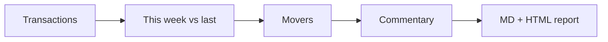

# Automated Sales Report Generator

> Every Monday at 8am: last week's numbers, what changed, and why, written for the MD.

     

**Sector:** Retail & Analytics  ·  **Project 12 of 50** in my [AI Automation Projects series](https://github.com/Princewill106/Princewill106)

## The problem

Someone spends every Monday morning copying numbers into a slide, and by the time the MD reads it nobody remembers what changed or why. The report exists, but the insight doesn't.

## How it works



1. **Load** — Read transactions (date, branch, product, qty, price) from `sample_sales.csv`.
2. **Compare** — Compute revenue, orders and average order value for the latest week and the week before.
3. **Movers** — Rank products and branches by revenue change.
4. **Explain** — Turn the changes into plain-English sentences (or LLM commentary when configured).
5. **Publish** — Write `output/weekly_report.md` and `output/weekly_report.html`, ready to email or post.

## Features

- Week-over-week KPIs
- Top and falling products
- Branch leaderboard
- Rule-based commentary with LLM upgrade
- Markdown and HTML output with inline bar chart

## Quick start

```bash
git clone https://github.com/Princewill106/sales-report-generator.git
cd sales-report-generator
python main.py --demo
```

No installs needed: it uses only the Python standard library. The demo runs fully offline using the sample data in this repo.

**Optional: plug in an LLM.** Copy `.env.example` to `.env` and add an Anthropic or OpenAI key. The project will then use the model for the language-heavy steps and fall back to its rule-based logic if a call fails.

Run the tests:

```bash
python -m unittest -v
```

## Sample output

```text
# Weekly sales report: 2026-09-29 to 2026-10-05

| Metric | This week | Last week | Change |
|---|---:|---:|---:|
| Revenue | 107,000 | 70,000 | +52.9% |
| Orders | 9 | 8 | +12.5% |
| Avg order value | 11,889 | 8,750 | +35.9% |

## What changed

- Revenue rose 52.9% to NGN 107,000.
- Biggest gain: Smoothie (+NGN 30,000).
- Biggest drop: Fried Rice (NGN 0).
- Top branch: Lekki with NGN 62,500.

## Branches

- Lekki: NGN 62,500
- Ikeja: NGN 35,000
- Yaba: NGN 9,500

Saved output/weekly_report.md and output/weekly_report.html
```

## Use it in n8n (no code needed)

[`n8n-workflow.json`](n8n-workflow.json) is a ready-to-import n8n version of this project, built for n8n 1.x.

1. In n8n, open **Workflows → Import from File** and choose `n8n-workflow.json`.
2. Click **Test workflow**. It runs the full logic on the sample data built into the *Sample data* node, so you can see the results before connecting anything.
3. Open each output node and connect your accounts: Gmail (OAuth2), Google Sheets (OAuth2). For Google Sheets, pick your spreadsheet and sheet.
4. Adjust the settings at the top of the **Logic** node (thresholds, templates, contacts), then **Activate**.

**Flow:** **Schedule (Mondays 8am)** → Read sales sheet → **Logic** (Code node)

**Outputs:**
- Email the MD

The Logic node is a JavaScript port of the rules in `main.py`, so you can run the project in n8n without Python.

## Use it on your own data

Export sales as CSV (`date,order_id,branch,product,qty,unit_price`) and run `python main.py --input sales.csv`. Schedule it weekly with cron, n8n or Make and email the HTML.

## Project structure

```text
n8n-workflow.json            Importable n8n workflow
.env.example                 Optional API key settings
.gitignore                   Git ignore rules
LICENSE                      MIT license
README.md                    This file
llm.py                       Optional LLM helper (offline fallback)
main.py                      Entry point and core logic
requirements.txt             Dependencies (stdlib only)
sample_sales.csv             Sample input data for the demo
test_main.py                 Unit tests
```

## Who this is for

- Retail chains and supermarkets
- Restaurants with several branches
- Distributors reporting to owners

## Ideas to extend it

- [ ] Email the report via SMTP
- [ ] Monthly and quarterly modes
- [ ] Target vs actual tracking
- [ ] Forecast next week's revenue

## About

Built by **Ogbu Ugochukwu Princewill**, AI Automation Lead and robotics engineer. I teach people and businesses to build with AI, not just talk about it. [LinkedIn](https://www.linkedin.com/in/ugochukwu-ogbu-653a0816a)

If this helped you, give it a ⭐ and share what you built with it.

## License

MIT — see [LICENSE](LICENSE).
